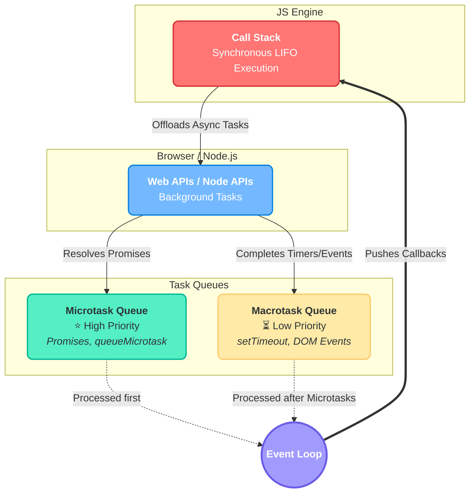

# JavaScript Notes →

> JavaScript is a `synchronous`, `blocking`, `single-threaded` language.

## Basics →

 

Variables

- **let** → Block-scoped variable. Can be updated (reassigned) but cannot be re-declared within the same scope. Preferred for variables whose values will change.

- **var** → Function-scoped variable. Can be updated and re-declared. It is legacy JavaScript and generally avoided in modern development due to hoisting quirks.

- **const** → Block-scoped variable. Cannot be updated or re-declared. It must be initialized at the time of declaration. Used for values that should never change.

 

 

Data Types

- **Primitive** → Immutable values that hold a single piece of data directly.

    - **String** → Represents textual data (e.g., `"Hello World"`, `'apple'`).
    - **Number** → Represents integers and floating-point numbers (e.g., `42`, `3.14`).
    - **Boolean** → Represents logical entities two values: `true` or `false`.
    - **Undefined** → A variable declared but has not yet been assigned a value.
    - **Null** → Represents absence of any object value (empty or non-existent).
    - **BigInt** → Used to represent integers larger Number (`2^53 - 1`).
    - **Symbol** → A unique and immutable value, used as an identifier for object properties.

- **Non-Primitive (Reference Types)** → Mutable values that store collections of data and complex entities.

  - **Objects** → Collections of key-value pairs. Arrays `[1, 2, 3]` and Functions.

 

 

Operators

- **Assignment** → Used to assign values to variables.
  - `=`, `+=`, `-=`, `*=`, `/=`, `%=` → Standard assignment and math assignment.
  - `??=`, `||=`, `&&=` → Assigns value if the current value is nullish, falsy, or truthy.

- **Arithmetic** → Used to perform mathematical operations.
  - `+`, `-`, `*`, `/` → Basic math.
  - `%` (Modulus) → Returns the division remainder.
  - `++`, `--` → Increments or decrements a value by 1.
  - `**` (Exponentiation) → Raises the 1st operand to the power of 2nd.

- **Comparison** → Used to compare values, returning (`true`/`false`).
  - `===` / `!==` → **Strict equality/inequality** .
  - `==` / `!=` → **Loose equality/inequality** .
  - `>`, `<`, `>=`, `<=` → Relational operators (Greater/less than).

- **Logical** → Used to determine the logic between variables or values.
  - `!` (NOT) → Reverses the boolean state.
  - `&&` (AND) → Returns `true` if *all* conditions are true.
  - `||` (OR) → Returns `true` if *at least one* condition is true.

- **Ternary (Conditional)** → (`? :`) Used as one-line shorthand of `if...else` statements.
  - Syntax: `condition ? expressionIfTrue : expressionIfFalse`
  - Example: `const status = age >= 18 ? "Adult" : "Minor";`

- **Optional Chaining** → (`?.`)
  - Example: `const zip = user?.address?.zipCode;` 
  - (Returns `undefined` instead of crashing if `address` doesn't exist).

- **Nullish Coalescing** → (`??`)
  - Example: `const name = userName ?? "Guest";`
  - Returns the right-hand value ONLY if the left-hand value is `null` or `undefined`.

- **Spread / Rest Syntax** → (`...`)
  - **Spread:** Expands an array or object into its individual elements. 
    - (e.g., `const newArr = [...oldArr, 4, 5]`).
  - **Rest:** Collects multiple elements and condenses them into a single array. 
    - (e.g., `function sum(...numbers) { }`).

- **String** → 
  - `+`, `+=` → Concatenates (joins) strings. 
  - *Note:* In modern development, **Template Literals** (backticks `` ` ``) are preferred.

- **Type / Object** →
  - `typeof` → Returns a string indicating the data type of the unevaluated operand
    - (e.g., `typeof "Hello"` returns `"string"`).
  - `in` → Returns `true` if a specified property exists in an object 
    - (e.g., `"name" in userObj`).
  - `instanceof` → Checks if an object belongs to a specific class or constructor.
  - `delete` → Removes a property from an object.

 

Conditionals

- **`if` Statement** → Executes a block of code only if a specified condition is `true`.

- **`else if` Statement** → Specifies a new condition to test if the first condition is `false`.

- **`else` Statement** → Executes a block of code if the same condition is `false`.

- **`switch` Statement** → Evaluates an expression and matches it against multiple `case` clauses. Always use `break` to stop the code from running into the next case, and `default` as a fallback.

 

Loops

- **`for` Loop** → Used when you know exactly how many times you want to loop through a block of code.

- **`while` Loop** → Loops through a block of code as long as a specified condition is `true`.

- **`do...while` Loop** → Executes the code block at least once before checking if the condition is `true`, then repeats as long as the condition is `true`.

- **`for...of` Loop** → Used to loop over the **values** of iterable objects (like Arrays or Strings).

- **`for...in` Loop** → Used to loop over the **keys** (properties) of an Object.

- **`break` Statement** → Immediately exits the entire loop.

- **`continue` Statement** → Skips the current iteration and jumps to the next one.

## Functions →

 

Types of Functions

- **Function Declaration** → Standard way to define function using `function` keyword.
  - These functions are "hoisted", meaning they can be called before they are defined.
  - Example: `function greet() { return "Hello"; }`

- **Function Expression** → Function stored in variable.
  - These are not hoisted and can only be called after they are defined.
  - Example: `const greet = function() { return "Hello"; };`

- **Arrow Function** → Arrow functions don't have their own `this` context -  great for callbacks.
  - Example: `const greet = () => "Hello";`

- **IIFE (Immediately Invoked Function Expression)** → Function executed the exact moment it is defined.
  - Example: `(function() { console.log("Run!"); })();`

- **Anonymous Function** → A function without a name.

- **Callback Function** → A function passed into another function as an argument.

 

 

Parameters & Arguments

- **Arguments** → The actual real values passed to the function when it is called.

- **Parameters** → The named variables listed inside the parentheses of a function definition.

- **Default Parameters** → Default values are used if no value (or `undefined`) passed.

- **Rest Parameters** → (`...`) Allows function to treat indefinite number of arguments as array.

- **Arguments Object** → A legacy, array-like object accessible inside standard functions (but *not* arrow functions) that contains the values of the arguments passed.

 

 

Scope & Closures

- **Global Scope** → Variables declared outside of any function or block. They can be accessed from anywhere in your code.

- **Local / Function Scope** → Variables declared inside a function. They cannot be accessed from outside that specific function.

- **Block Scope** → Variables declared inside a `{}` block (using `let` or `const`). They exist only within that block.

- **Lexical Scope** → A function's ability to access variables from its parent scope where it was physically defined in the source code.

- **Closure** → A powerful feature where an inner function "remembers" and has access to the variables and parameters of its outer function, even after the outer function has finished running.

 

 

Advanced Concepts

- **Higher-Order Functions** → Functions that operate on other functions.
  - e.g. array methods like `map()`, `filter()`, and `reduce()`.

- **Generator Functions** → Defined using `function*`. They can pause their execution halfway using the `yield` keyword and resume later, returning an iterator object.

- **`this` Keyword** → Refers to the object that is executing the current function.
  - In a method, `this` refers to the owner object.
  - In a regular function, `this` refers to the global object (or `undefined` in strict mode).
  - *Note:* Arrow functions do not bind their own `this`.

- **Method Borrowing / Binding** → Built-in methods to control what `this` refers to in a function.
  - **`call()`** → Invokes the function immediately with a specific `this` context and individual arguments.
  - **`apply()`** → Same as `call()`, but takes arguments as an array.
  - **`bind()`** → Returns a new function with a permanently bound `this` value, which can be executed later.

 

## Asynchronous JS →

 

Promises & Combinators

- **Promise** → An object representing the eventual completion (or failure) of an asynchronous operation. It has three states: `Pending`, `Fulfilled` (resolved), or `Rejected`.

- **Promise Combinators** → Methods to handle multiple promises concurrently.

  - **`Promise.all(iterable)`** → 
    - Waits for *all* promises to resolve and returns array of their results. 
    - If *any* promise rejects, the entire `Promise.all` immediately rejects (Fail-fast).
  - **`Promise.allSettled(iterable)`** → 
    - Waits for *all* promises to settle (either resolve or reject). 
    - Returns an array of objects (`{status, value/reason}`) for each promise.
  - **`Promise.race(iterable)`** → 
    - Returns the result of the *first* promise to settle, whether it resolves or rejects. 
  - **`Promise.any(iterable)`** → 
    - Returns the result of the *first* promise to successfully resolve. 
    - It only rejects if *all* given promises reject (returns an `AggregateError`).

 

 

Async/Await

- **`async` keyword** → Added to a function declaration to ensure it always returns a Promise. If the function returns a non-promise value, it is automatically wrapped in a resolved Promise.

- **`await` keyword** → Can only be used inside an `async` function. It pauses the execution of *that specific async function* until the awaited Promise settles. 

- **Under the Hood** → `async/await` is syntactic sugar over standard Promises and Generators. While the async function is paused via `await`, it frees up the Call Stack, allowing other synchronous code or tasks to run. Once the awaited Promise resolves, the remainder of the async function is pushed to the **Microtask Queue** to resume.

 

 

Error Handling

- **`try...catch` Block** → The standard way to handle errors in `async/await`. 

- **Promise `.catch()`** → Chained to a Promise to handle rejection errors. If an error is thrown inside a `.then()`, it automatically propagates down the chain to the nearest `.catch()`.

## Object-Oriented Programming (OOP) →

 

The 4 Pillars of OOP

- **Encapsulation** → Bundling data (variables) and methods (functions) into a single unit (object) and restricting direct access to some of its internal states to prevent unintended interference.

- **Abstraction** → Hiding complex, under-the-hood implementation details and exposing only the essential, easy-to-use parts to the user.

- **Inheritance** → The mechanism where one class (child) derives properties and methods from another class (parent), promoting code reusability.

- **Polymorphism** → The ability for different classes to be treated as instances of the same class through a common interface. In JS, this often means overriding a parent's method in a child class to behave differently.

 

 

Prototypes & The Prototype Chain

- **Prototype** → Every JavaScript object has a hidden internal property called `[[Prototype]]` (historically accessed via `__proto__`). It points to another object to inherit properties and methods from.

- **Prototypal Inheritance** → JavaScript's native way of doing OOP. Instead of classical inheritance (like Java/C++), objects directly inherit from other objects.

- **Prototype Chain** → When you try to access a property on an object, JS first checks the object itself. If it can't find it, it travels up the "chain" to the object's prototype, and then *that* prototype's prototype, until it finds the property or reaches `null`.

- **`Object.create()`** → A method used to create a new object, using an existing object as the prototype of the newly created object.

 

 

Classes & Instances (ES6+)

- **`class` Keyword** → Syntactic sugar over JavaScript's traditional prototype-based inheritance. It provides a much cleaner, more classical-looking blueprint for creating objects.

- **`constructor()`** → A special method automatically called when a new object is created from a class. Used to initialize the object's properties.

- **`new` Keyword** → Used to create an instance of a class. It creates an empty object, binds `this` to it, and returns the object.

  - Example: `const user1 = new User('Ravi', 25);`
- **Instance** → A specific, realized object built from a class blueprint (e.g., `user1` is an instance of the `User` class).

- **`this` Keyword** → Inside a class, `this` refers to the specific instance of the object being created or operated on.

 

 

Inheritance & Modifiers (Modern JS)

- **`extends`** → Used to create a child class that inherits all properties and methods from a parent class.
  - Example: `class Admin extends User { }`

- **`super()`** → A special function used inside a child class's constructor to call the parent class's constructor. It **must** be called before you can use `this` in the child constructor.

- **Static Methods (`static`)** → Methods (or properties) that belong to the Class itself, NOT to the instances of the class. They are called directly on the class (e.g., `Math.random()` or `User.compare(user1, user2)`).

- **Getters & Setters (`get` / `set`)** → Special methods that allow you to bind an object property to a function. They let you run logic when reading or changing a property while making it look like a regular variable.

- **Private Fields & Methods (`#`)** → (ES2022) Prefixing a property or method with `#` makes it strictly private. It can only be read or modified from inside the class itself, strictly enforcing Encapsulation.
  - Example: `#password = 'secret';`

 

 

Key Differences: Classical vs. Prototypal

- **Classical OOP (Java/C++)** → Classes are strict blueprints. Objects are created from them. Classes inherit from classes.

- **Prototypal OOP (JavaScript)** → Classes (in JS) are just functions under the hood. Objects inherit directly from other objects via prototypes. You can add or modify methods on a prototype at runtime, and all instances instantly inherit those changes.

